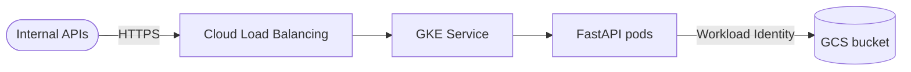

# Keygroup — File Retrieval Platform

Platform Engineer assessment: Terraform (GCP/GKE) + Python microservice retrieving user files from GCS.

## Architecture



## Repository layout

```
*.tf                      # Root module: wires the modules below (backend in versions.tf)
terraform.tfvars          # The single environment: floci-gcp
modules/                  # network, gke, iam, storage, artifact-registry, project-services
app/                      # Python FastAPI service + tests + sample data
helm/keygroup-api/        # Helm chart: app, nginx, Prometheus, Grafana, logging agent
.github/workflows/ci.yml  # Lint, unit tests, make floci-up
docker-compose.floci.yml  # floci-gcp emulator
```

Run `make help` for every command.

---

## Deploy (one command)

[floci-gcp](https://github.com/floci-io) emulates the GCP APIs in a container. The same Terraform and Helm used for real GCP run against it. No GCP account is needed.

### Installing floci

floci-gcp is a Docker image (`floci/floci-gcp`, about 260MB), not something you install on your machine. `make floci-up` starts it with `docker compose -f docker-compose.floci.yml`, which pulls the image the first time. All you need is the tools that drive it:

```bash
# macOS (Homebrew)
brew install --cask docker          # Docker Desktop, then start it
brew install terraform kubectl helm

# Optional: pull the emulator image ahead of time
docker pull floci/floci-gcp:latest
```

| Tool | Version | Used for |
|------|---------|----------|
| Docker | running daemon | floci-gcp, plus the k3s container it creates for the GKE cluster |
| Terraform | ≥ 1.5 | Creating the GCP resources on floci |
| kubectl | any recent | Talking to the emulated GKE cluster |
| Helm | 3.x | Deploying the app, nginx and observability stack |
| curl, `file`, python3 | preinstalled on macOS / Ubuntu | Seeding data, smoke tests, `make floci-logs` |

On Linux, install Docker Engine plus the same three tools from your package manager or their official install pages. CI's Ubuntu runners already have everything but Terraform.

**Optional: the floci CLI.** It isn't needed for this repo, but it's handy for poking at the emulator:

```bash
brew install floci-io/floci/floci
floci gcp status      # health and version of the running emulator
floci gcp services    # which GCP APIs are emulated
floci gcp logs        # emulator logs
```

Don't use `floci gcp start` / `stop` here. `make floci-up` / `make floci-down` manage the container, its volume and the k3s cluster together, and the CLI would start a separate container.

**Check it's working:**

```bash
make floci-start                                  # start just the emulator
curl -s 'http://localhost:4588/storage/v1/b?project=floci-local'   # responds with JSON
```

### Run it

```bash
make floci-up
```

That runs, in order:

| Step | Target | What happens |
|------|--------|--------------|
| 1 | `floci-start` | `docker compose up` the emulator; create the `floci-tfstate` bucket for Terraform state |
| 2 | `floci-infra` | `terraform init` + `terraform apply` (`terraform.tfvars` is auto-loaded) |
| 3 | `floci-seed` | Upload `app/sample-data/users/**` to the customer-files bucket |
| 4 | `floci-kubeconfig` | floci-gcp runs the GKE cluster as a k3s container; write `.floci/kubeconfig` for it |
| 5 | `floci-deploy` | Build the image, import it into k3s, `helm upgrade --install` (app + nginx) |
| 6 | `floci-test` | Call the app and nginx from inside the cluster |

Each target can also be run on its own, and running `make floci-up` again is safe.

```bash
make k8s-port-forward        # app → :8080, nginx → :8081

curl http://localhost:8080/v1/users/user-1/files/profile.json
open http://localhost:8081

make floci-down              # remove emulator, cluster, state
```

**How the emulator is wired:**
- `terraform.tfvars` sets `emulator_endpoint`, which makes the google provider in `versions.tf` send every API call to floci-gcp. Leave it empty to run the same code against real GCP.
- Terraform state lives in the emulator's own GCS (the `gcs` backend in `versions.tf`), so `floci-down` wipes it with everything else.
- floci-gcp doesn't emulate Artifact Registry or Cloud Router, so `terraform.tfvars` sets `enable_artifact_registry = false` and `enable_nat = false`.
- Pods reach the emulator through a `floci-gcp` hostAlias (`flociIP`), with `STORAGE_EMULATOR_HOST=http://floci-gcp:4588` set in `helm/keygroup-api/templates/app.yaml`.
- To use kubectl/helm directly: `export KUBECONFIG=$PWD/.floci/kubeconfig`.

---

## Observability & SLOs

Requirements: **99.99% success rate** and **99.99% of responses within 300ms**.

```bash
make k8s-port-forward    # Grafana → http://localhost:3000 (no login), Prometheus → :9090
make floci-load          # 100 req/s for 2m = 12,000 requests (LOAD_QPS / LOAD_DURATION to change)
make floci-logs          # latest app request logs from Cloud Logging on floci
```

| Piece | What it does | On real GKE |
|-------|--------------|-------------|
| App `/metrics` | `http_requests_total{status}` and the `http_request_duration_seconds` histogram (with a 0.3s bucket, so "within 300ms" is an exact count) | same |
| Prometheus | Scrapes pods annotated `prometheus.io/scrape` every 5s | Google Managed Prometheus (enabled in `modules/gke`) |
| Grafana | "Keygroup API SLOs" dashboard: success rate, % within 300ms, error budgets, latency percentiles | Grafana or Cloud Monitoring |
| App stdout | One JSON line per request (`severity`, `status`, `latency_ms`) | same |
| `logging-agent` (Vector DaemonSet) | Ships every container's stdout/stderr to Cloud Logging on floci as `logs/stdout\|stderr`, resource `k8s_container` | GKE's built-in logging agent |

Measuring 99.99% needs at least 10,000 requests; below that a single failure already breaks it.

### Load testing (`make floci-load`)

`make floci-load` runs one command. It starts a temporary [fortio](https://fortio.org) pod inside the cluster, which sends steady traffic to the app and prints the results:

```bash
kubectl -n keygroup run loadtest --rm -i --restart=Never --image=fortio/fortio:1.75.3 -- \
  load -qps 100 -t 2m -c 8 -p "50,99,99.9,99.99" \
  http://keygroup-api/v1/users/user-1/files/profile.json
```

| Part | Meaning |
|------|---------|
| `kubectl run loadtest --rm -i --restart=Never` | Run a one-off pod, stream its output, delete it when done |
| `-qps 100` | 100 requests per second, at a steady rate (`LOAD_QPS`, 0 = as fast as possible) |
| `-t 2m` | For 2 minutes, i.e. 12,000 requests (`LOAD_DURATION`) |
| `-c 8` | 8 parallel connections |
| `-p "50,99,99.9,99.99"` | Latency percentiles to report; p99.99 is the latency SLO |
| `http://keygroup-api/...` | The app's Service, by its in-cluster name |

It runs inside the cluster so the numbers measure the app, not a `kubectl port-forward` tunnel from your laptop.

```
fortio pod ──100 req/s──▶ keygroup-api Service ──▶ app pod ──▶ floci GCS (fetch file)
                                                      │
                      ┌───────────────────────────────┴──────────────────────┐
           /metrics (counter + histogram)                     one JSON log line per request
                      │                                                      │
           Prometheus scrapes every 5s                       logging agent (Vector)
                      │                                                      │
           Grafana dashboard                                 Cloud Logging on floci
```

**Reading the results:**
- **fortio output (client side):** `Code 200 : 12000 (100.0 %)` is the success rate, and `# target 99.99% 0.2309` is the p99.99 latency in seconds, which must be under `0.3`.
- **Grafana (server side):** the same traffic as the app recorded it, a little faster because it excludes the in-cluster network hop.

**Variations:**

```bash
make floci-load LOAD_QPS=200 LOAD_DURATION=5m     # longer run, 60,000 requests
make floci-load LOAD_QPS=0 LOAD_DURATION=30s      # max throughput of one pod

# More pods (Prometheus finds them automatically; the next make floci-up resets to 1)
KUBECONFIG=.floci/kubeconfig kubectl -n keygroup scale deploy/keygroup-api --replicas=3
make floci-load LOAD_QPS=500
```

To change the URL or concurrency, run the `kubectl run` command above directly with your own values.

---

## CI

`.github/workflows/ci.yml` runs on every PR and push to `main`. It needs no GCP account or secrets:

1. `make lint`: `terraform fmt -check`, `terraform validate`, `helm lint`
2. Unit tests (`pytest`)
3. `make floci-up` on the runner (the full terraform + helm deploy and smoke test), then `make floci-down`

---

## Running the app without Kubernetes

```bash
cd app
python -m venv .venv && .venv/bin/pip install -r requirements-dev.txt
LOCAL_STORAGE_PATH=./sample-data .venv/bin/uvicorn file_service.main:app --app-dir src --port 8080
curl http://localhost:8080/v1/users/user-1/files/profile.json

make test
```

## Environment variables

| Variable | Purpose | Value on the cluster |
|----------|---------|----------------------|
| `GCS_BUCKET` | Bucket holding `users/<id>/files/<file>` | Terraform output `customer_files_bucket` |
| `STORAGE_EMULATOR_HOST` | Point the GCS SDK at an emulator | `http://floci-gcp:4588` |
| `LOCAL_STORAGE_PATH` | Serve from local disk instead of GCS | unset |
| `APP_ENV` | Environment label | `floci` |
| `LOG_LEVEL` | Log verbosity | `DEBUG` |

## Design decisions

| Aspect | Choice | Why |
|---|---|---|
| Framework | FastAPI | Fast, async, auto-docs, built-in validation |
| Storage | GCS (local FS for dev) | Testable offline, production-ready |
| Auth | None (internal) | Consumed by other services; edge handles auth |
| Deploy | Helm | Single chart, env-specific values |
| Local GCP | floci-gcp | Runs the real Terraform + Helm locally, including a GKE cluster |

## Stretch (not implemented)

- API keys / mTLS at edge
- Prometheus metrics + SLO alerts
- Signed URLs for large files
- Ingress + managed TLS certs
- External Secrets / Secret Manager integration
